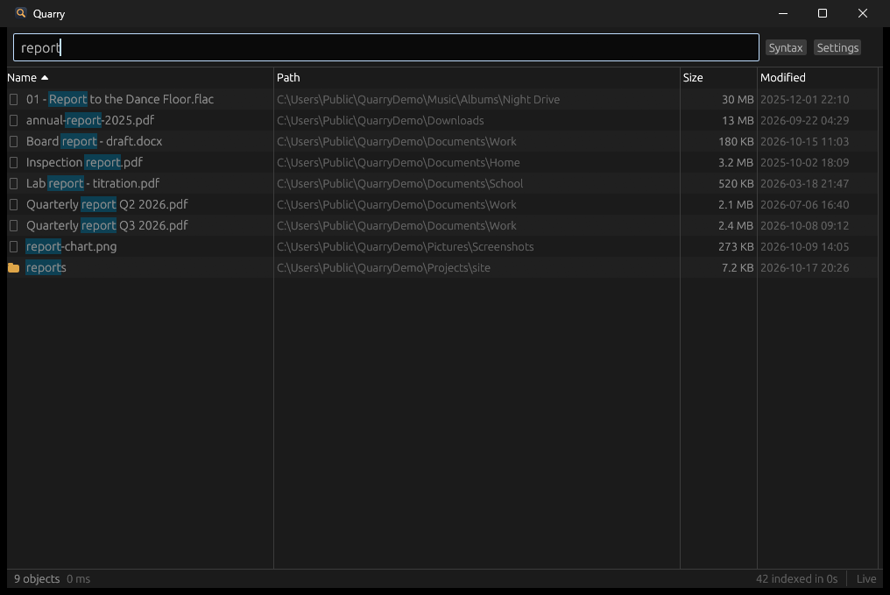

# Quarry

Instant file search for Windows, macOS and Linux, with the search syntax of
[Everything](https://www.voidtools.com/).



Type part of a file name and the matches show up as you type, from every indexed drive, sorted
however you like. Quarry keeps a compact index of every file and folder name in memory and follows
file system changes as they happen, so results stay current without rescanning.

Everything is the tool Windows users miss most when they move to a Mac or Linux. Linux has FSearch,
and macOS has Cardinal. Each covers one platform. Quarry is one open-source app with the same
syntax on all three. It also has what those projects' issue trackers ask for most: dragging results
into other apps, live index updates, a tray icon with a global shortcut, a command-line interface and
an HTTP API.

It's a single native binary written in Rust, with no runtime to install.

## Download

Get the latest build from the [Releases page](https://github.com/fsiuhgshiqoih32/quarry/releases/latest).

| Platform | Download |
|---|---|
| Windows 10 and 11 (x64, ARM64) | `quarry-<version>-windows-x64.zip` or `-windows-arm64.zip` |
| macOS 11 or later (Apple silicon and Intel) | `quarry-<version>-macos.zip` |
| Linux x86_64 | `quarry-<version>-linux-x86_64.tar.gz` or `quarry_<version>_amd64.deb` |

Unzip it and run it. The first index of a large drive takes a minute or so (5.4 million files took
about 40 seconds in testing). Later launches search the saved index straight away and bring it up
to date in the background.

**Windows:** the exe isn't code-signed, so SmartScreen may warn on first launch. Choose
"More info", then "Run anyway". The zip also has `quarry-cli.exe`, a console build for scripts.

**macOS:** the app is ad-hoc signed, not notarized. Right-click it and choose Open the first time.
Give it Full Disk Access (System Settings > Privacy & Security) to see Mail, Messages and other
protected folders; without it those folders are just left out.

**Linux:** the tray icon needs GTK 3 and `libayatana-appindicator3`, and the window needs
`libxkbcommon-x11` (all installed on most desktops). The `.deb` pulls them in. The global shortcut works on X11; on Wayland, bind your desktop's own
shortcut to `quarry` instead (a second launch brings the running window forward).

## Search syntax

Plain words match anywhere in the name, ignoring case. Everything else builds on that.

| Query | Finds |
|---|---|
| `report 2026` | names containing both words |
| `jpg\|png` | either word |
| `!temp` | names without the word |
| `<jpg\|png> holiday` | grouping with `< >` |
| `"my file"` | a phrase with a space |
| `*.mp3`, `draft-??` | wildcards, matched against the whole name |
| `projects/notes` | a term with a slash matches the full path |
| `ext:pdf;docx` | by extension |
| `size:>100mb`, `size:1mb..5mb`, `size:huge` | by size (`empty`, `tiny`, `small`, `medium`, `large`, `huge`, `gigantic`) |
| `dm:today`, `dm:last7days`, `dm:thismonth` | by date modified |
| `dm:2026-01-01..2026-03-31`, `dm:>2025` | by date, with ranges and comparisons |
| `file:`, `folder:` | only files or only folders |
| `parent:"C:\Users\me"` | directly inside a folder |
| `case:Readme` | match case |
| `ww:log` | whole word |
| `regex:^IMG_\d{4}\.jpe?g$` | regular expression |
| `path:src main` | match this term against the full path |
| `startwith:IMG`, `endwith:.bak` | start or end of the name |

Modifiers combine (`case:path:Src`), and `OR`, `AND` and `NOT` work as words too. Press F1 in the
app for the cheat sheet.

## Using it

- **Keyboard:** Down moves from the search box into the results, Enter opens, Ctrl+Enter (Cmd+Enter)
  shows the file in Explorer or Finder, Ctrl+C copies full paths and Ctrl+Shift+C copies names.
  Typing while the list has focus goes back to the search box. Esc clears the search, then hides
  the window.
- **Mouse:** double-click opens; right-click for open, show in folder, copy, and "search in this
  folder". Shift- and Ctrl-click select several. Click a column header to sort, again to reverse.
- **Drag and drop:** drag rows into Explorer, Finder, a mail or chat window, or an editor
  (Windows and macOS).
- **Tray and shortcut:** Alt+Shift+Space (Option+Shift+Space on macOS) shows the window from
  anywhere; press it again to hide. Closing the window keeps Quarry in the tray. Both are in
  Settings, along with start at login.
- **From a launcher:** `quarry --query "ext:pdf invoice"` opens the window with that search, or
  sends it to the window that's already open.

## Command line

```
quarry search ext:pdf invoice dm:thisyear      # print matching paths
quarry search -n 0 --sort size --desc folder:   # every folder, biggest first
quarry search --json report | jq .path          # one JSON object per line
quarry search --count "*.rs"                     # just the number
quarry index                                     # rebuild and save the index
quarry serve --port 7837                         # HTTP API without a window
quarry paths                                     # where settings and the index live
```

`quarry search` reads the index the app saved; add `--rescan` to rebuild it first. On Windows use
`quarry-cli.exe` from scripts (the main exe is a GUI app, so terminals don't wait for it).

## HTTP API

Turn it on in Settings (or run `quarry serve`) and it answers on `127.0.0.1` only:

```
GET http://127.0.0.1:7837/search?q=report&limit=50&offset=0&sort=size&desc=1
GET http://127.0.0.1:7837/status
```

Results come back as `{"total": n, "offset": 0, "results": [{"name", "path", "folder", "size",
"modified"}]}`. Requests with a non-loopback `Host` header are refused, so web pages can't read
your file list through DNS rebinding.

## What gets indexed

By default: every local fixed drive on Windows, and `/` on macOS and Linux. Virtual and network
file systems are skipped (`/proc`, `/sys`, snaps, WSL's Windows drives, NFS and SMB mounts, sshfs),
as is the second view of the macOS data volume. In Settings you can pick folders, and skip folders
by full path or by name anywhere (`node_modules`, `*.cache`).

Live updates use the OS's change notifications: ReadDirectoryChangesW on Windows, FSEvents on
macOS, inotify on Linux. If Windows drops events anyway (a burst bigger than its 512 KiB buffer),
Quarry refreshes that drive. inotify needs one watch per folder; Quarry watches every indexed
folder, your home folder first. If the system limit runs out, the status bar says so and the
folders without a watch are refreshed hourly. To raise the limit:

```bash
echo fs.inotify.max_user_watches=1048576 | sudo tee /etc/sysctl.d/90-quarry.conf && sudo sysctl --system
```

At start-up Quarry brings the saved index up to date in place, folder by folder, to catch changes
made while it wasn't running. Searches work throughout, and quitting part-way keeps what was done.

Memory use is roughly 75 bytes per file. With 5.4 million files in testing, the index held 330 MB
after loading and 395 MB after a full scan, and start-up peaked at about 530 MB.

## Files

| | Windows | macOS | Linux |
|---|---|---|---|
| Settings | `%APPDATA%\quarry\config.toml` | `~/Library/Application Support/quarry/config.toml` | `~/.config/quarry/config.toml` |
| Index | `%LOCALAPPDATA%\quarry\index.bin` | `~/Library/Caches/quarry/index.bin` | `~/.cache/quarry/index.bin` |

Set `QUARRY_HOME` to keep both in one folder instead (for a portable copy, say).

The window draws with OpenGL and falls back to wgpu (Direct3D 12, Metal or Vulkan, with a software
adapter if there's no GPU) when OpenGL 2 isn't available, as in many virtual machines and remote
desktops. Set `QUARRY_RENDERER=wgpu` to skip the OpenGL attempt.

## Building

Rust 1.89 or later.

```
cargo build --release
```

On Linux install `libgtk-3-dev libayatana-appindicator3-dev libxdo-dev libxkbcommon-dev` first, or
build without the tray icon: `cargo build --release --no-default-features`.

`cargo test` runs the unit tests; `cargo run -- self-test` checks scanning, searching, saving, live
updates and the HTTP API in a temporary folder, and `self-test --gui` opens the window as well.
`cargo run --release --example bench` times a scan and some searches on your own drives.

## License

MIT
